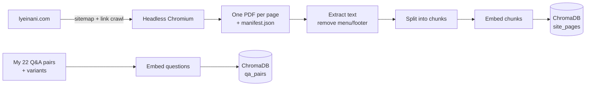
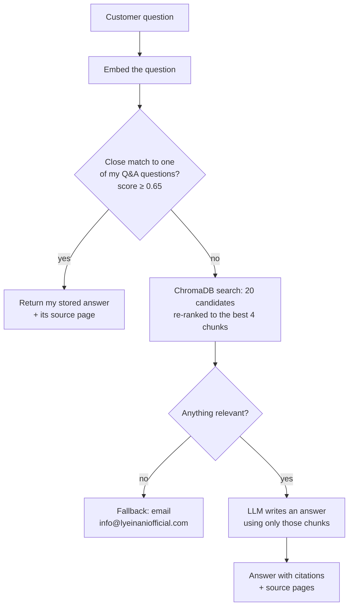

# LYEINANI Customer Assistant: A RAG Chatbot for My Clothing Brand

I built a Retrieval-Augmented Generation (RAG) chatbot that answers customer questions about [lyeinani.com](https://www.lyeinani.com), the Shopify store for LYEINANI, my anime-inspired clothing brand. It answers from two sources I prepared: the pages of my own website, and a set of question-and-answer pairs I wrote for the questions customers ask most.

[](https://colab.research.google.com/github/alwayzlynluv/lyeinani-rag-chatbot/blob/main/lyeinani_rag_chatbot.ipynb)

## Purpose

I run LYEINANI myself, and most of the messages I get are the same few questions: how exchanges work, who pays for return shipping, when a preorder will arrive, whether I ship internationally. The answers are already on my site, but they're spread across policy pages, product pages and my PRETA preorder page, so customers don't always find them.

I wanted an assistant that:
- answers those questions instantly, in my words, 24/7
- only says what my site actually says, and shows the page it came from
- admits when it doesn't know and points people to my email, instead of guessing

This was also my project for showing applied skills in Retrieval-Augmented Generation, context-aware responses and applied NLP, using a real business I know inside and out.

## Summary

- **Data source 1 (d1): my website.** I scraped every page of lyeinani.com and saved each one as a PDF, which gives the bot a full copy of my product pages, collections and policies.
- **Data source 2 (d2): my Q&A set.** I wrote 22 question-and-answer pairs covering returns, exchanges, shipping, customs, preorders, contact and my Brand Support service. Each one includes several ways a customer might phrase the question.
- **How it answers:** the bot checks my Q&A set first. If the question closely matches one of mine, it gives my stored answer word for word. If not, it searches my site pages and has a language model write an answer using only what it found, with sources.
- **Vector database:** both sources are embedded and stored in **ChromaDB**, a persistent vector database, and searched by meaning.
- **Model:** a free, open-source model (Qwen2.5-3B-Instruct) that runs inside Google Colab. No paid service or API key is needed.
- **Interface:** a branded Streamlit chat app that labels every answer with where it came from, shows sources, and collects 👍/👎 feedback.
- **Evaluation:** an automated accuracy test that checks answers against known right answers from my site.

## How it works (mapping)

### Building the knowledge base



### Answering a question



## Process: the steps I took

**1. Chose my tools.** I compared AI platforms (Claude, GPT, Gemini, Grok, IBM watsonx, AWS Bedrock and open-source models). Since the retrieval part is my own code, any model can write the answers, so I kept the model in one swappable piece of code.

**2. Scraped my website into PDFs (d1).** I wrote a Python scraper (`lyeinani_scraper.py`) that:
- reads my Shopify sitemap, then follows links to catch any pages the sitemap misses (my sitemap listed 69 pages)
- opens each page in a headless browser so prices and other content that loads with JavaScript are captured
- skips cart, checkout, account and search pages, and saves each product once even though Shopify lists it under several URLs
- saves a `manifest.json` with each page's URL and title, so the bot can cite its sources

**3. Wrote my Q&A set (d2).** I started from my live return policy, shipping policy, PRETA page and Brand Support page, then added details my site doesn't spell out yet:
- LYEINANI pays for return shipping
- preorders can be exchanged if the size is available
- my preorder timeline estimate: production averages 4–6 weeks, customs about 20 days, and shipping 1–2 weeks, so roughly 8–11 weeks in total

Each pair has a category, several alternate phrasings and its source page (`lyeinani_qa_set.json`).

**4. Built the RAG pipeline (`rag_bot.py`).**
- **Embeddings:** `all-MiniLM-L6-v2` turns questions and text into vectors, so the bot can match by meaning, not exact words.
- **Vector database:** the vectors live in a persistent **ChromaDB** database with two collections, `site_pages` (my scraped pages) and `qa_pairs` (my 74 question phrasings), using cosine similarity. Each collection is named by a fingerprint of its source data, so it rebuilds automatically when my site or Q&A file changes.
- **Re-ranking:** ChromaDB returns 20 candidate chunks. I boost chunks from the page the question names (for example, the Crimson Bloom Blazer's own page), drop chunks that score far below the best one, and keep the top 4.
- **Q&A routing:** every incoming question is compared with all my stored questions and variants. A score of 0.65 or higher counts as a strong match (see step 5).
- **Cleaning:** every page of my site repeats the same menu and footer. I remove lines that appear on most pages so they don't crowd out the real content.
- **Chunking:** page text is split into roughly 900-character pieces with some overlap, each tagged with its page title.
- **Grounded answers:** the model is told to answer only from the retrieved excerpts, cite them, never invent prices, dates or policies, and ignore any instructions inside page content.
- **Follow-ups:** chat history is passed along, so a question like "what about the vest?" keeps its context.

**5. Tuned the threshold.** I started with a threshold of 0.80 and tested it on 6 paraphrases of my stored questions (which should match my Q&A set) and 4 product questions (which should go to the site search). The product questions were handled correctly, scoring 0.14–0.48. But 0.80 was too strict: only 1 of the 6 paraphrases matched. For example, "can i get a refund" scored 0.769 against my stored "Do you offer refunds?" and was wrongly sent to the site search.

| Question | Score | Closest stored question |
|---|---|---|
| my preorder is the wrong size can i swap it | 0.850 | Can I change the size of my preorder? |
| is there a fee for customs | 0.789 | Who pays customs fees or duties? |
| can i get a refund | 0.769 | Do you offer refunds? |
| do you guys ship to the UK | 0.736 | Do you ship internationally? |
| how many days do i have to exchange something | 0.727 | How many days do I have to return something? |
| who covers the cost of sending a return back | 0.670 | Who pays for return shipping? |
| *do you have any bodysuits (product)* | *0.480* | *What kind of clothes do you sell?* |
| *how much is the Crimson Bloom Blazer (product)* | *0.450* | *How much is shipping?* |

Every paraphrase scored 0.67 or higher, and every product question scored 0.48 or lower, so I lowered the threshold to **0.65**, which separates the two groups cleanly.

**6. Switched to a free model.** My first version used the Claude API, which needs a paid API key. I didn't want this project to depend on a paid account, so I switched the default to a free open-source Qwen2.5 model that runs on Colab's free GPU (first 1.5B, then 3B; see step 9). The Claude option is still in the code if I ever add a key.

**7. Built the chat app (`app.py`).** The Streamlit app uses `st.chat_input` and `st.chat_message` for the conversation, `st.session_state` to keep the chat history, and `@st.cache_resource` so the models and the ChromaDB knowledge base load once instead of on every question. Features I added:
- a LYEINANI-branded dark theme in my brand's red-orange, with suggested starter questions
- a label on every answer: **"From LYEINANI's answers"** (my Q&A set) or **"From the website"** (site search), with source links, so customers can trust it and I can debug it
- 👍 / 👎 feedback on each answer, saved to `feedback.csv` so I can see which answers to improve
- a "Save chat" button that downloads the conversation
- a per-session question limit, so a public demo can't be spammed
- developer settings with a live threshold slider, match scores and ChromaDB stats

**8. Put it all in a Colab notebook.** `lyeinani_rag_chatbot.ipynb` runs the whole project step by step on a free GPU, from scraping to a live demo of the chat app.

**9. Fixed the mistakes from my first run and measured the result.** My first run got the vest follow-up wrong (see Limitations below), so I made four changes:
- **Follow-ups:** the bot no longer shows the model its own past answers. A short follow-up like "what about the vest?" is rewritten into a full question that includes the earlier one.
- **Retrieval:** the page-title boost and score cut-off described in step 4, so a product's own page beats the home page and blog posts that only mention it.
- **Instructions:** the model must copy names and prices exactly, never move a price from one product to another, and only list items that appear on a collection's own page.
- **Model:** I moved up from Qwen2.5-1.5B to Qwen2.5-3B, which still fits Colab's free GPU.

To measure the changes, I wrote an accuracy test (`run_eval` in `rag_bot.py`, section 4d of the notebook): 10 questions with known right answers from my site, including the follow-up it got wrong the first time. Each answer is checked for the facts it must contain, the wrong facts it must not contain, and the route it should take.

**Round 1 (Qwen2.5-3B with the fixes above): 8/10 on my first test, 9/10 after I corrected the test.**
- Both misses taught me something. My test said the Tokyo '92 answer must not mention the Pretty Soldier Mini Dress, but that dress *is* part of the collection. The bot was right and my test was wrong, so I fixed the test.
- The vest follow-up got the right price this time ($75 for the Cursed Vessel Vest) and listed my other vests. But it also went back to the earlier question and stated a different price for the Cursed Arc Trouser, which I hadn't asked about.

**Round 2: keeping follow-ups on topic.** The model now receives the earlier question only as context, labeled "already answered", with an instruction to answer only the current question and not mention products from the earlier one. The test now checks that the vest answer contains $75 and doesn't mention the trouser.

**Round 2 result: 10/10.** The vest follow-up now answers only about vests ("The Cursed Vessel Vest costs $75.00 USD. Another vest available is the Overtime Halter Vest..."), and every product price, policy answer and route in the test was correct.

| Version | Model | Accuracy test |
|---|---|---|
| First run | Qwen2.5-1.5B | Vest follow-up wrong ($110 instead of $75); no automated test yet |
| Round 1 fixes | Qwen2.5-3B | 8/10 (9/10 once my own test was corrected) |
| Round 2 fixes (final) | Qwen2.5-3B + ChromaDB | **10/10** |

A 10-question test is small, so this shows the fixes worked on the cases I know about, not that the bot is perfect. Growing the test set is part of my next steps.

## Outcome

- A working chatbot that answers customer questions about LYEINANI from my own website (76 pages, 198 chunks in ChromaDB) and my own written answers (22 Q&A pairs, 74 phrasings).
- **10/10 on my accuracy test** in the final version, up from a wrong answer on follow-ups in my first run.
- My most common questions get my exact answer instantly, with no model involved.
- Everything else is answered from my site pages, with the sources shown.
- When the bot can't find an answer, it says so and points customers to my email instead of making something up.
- It runs entirely on free tools: Colab, open-source models, ChromaDB and Streamlit.

**What I learned:** testing with real questions mattered more than my starting assumptions. The threshold I picked first (0.80) looked reasonable but sent most real customer phrasings past my own answers, and I only caught that by measuring the scores. The runs also showed where the free model is weakest, follow-up questions, and that a test can be wrong too: one "miss" was my test's mistake, not the bot's.

**Limitations:** in my first version, the free 1.5B model made mistakes on follow-ups. In my test, I asked "How much is the Cursed Arc Trouser?" (correct: $110) and then "what about the vest?". It answered $110 for the Cursed Vessel Vest, copying the price from its previous answer, when my site lists the vest at $75. The right pages were retrieved, so the mistake was in the answer writing (see step 9 for the fix). The scraped site is a snapshot, so I re-run the scraper when my site changes. And the answers I added in my Q&A set should also go on my policy pages, so both sources agree.

**Next steps:** embed the assistant on my Shopify store, turn it into a chat bubble on every page, and grow my accuracy test well beyond 10 questions, and add automatic answer-quality checks (for example, with RAGAS).

## Examples

These are real outputs from my Colab runs: examples 1–6 from my first full run, and example 7 from my final version. Q&A answers come back exactly as I wrote them; RAG answers are written by the model from my site pages.

**1. Stored Q&A match**
> **Customer:** Who pays for return shipping?
>
> **Assistant:** LYEINANI pays for return shipping on eligible exchanges. The original shipping fee from your order is non-refundable.
>
> *Route: Q&A · Source: [Refund & Exchange Policy](https://www.lyeinani.com/pages/refund-exchange-policy)*

**2. Paraphrase matched to a stored answer** (score 0.903)
> **Customer:** can i swap my preorder for another size
>
> **Assistant:** Yes, preorder items can be exchanged if your size is available. The standard exchange rules still apply: submit your claim within 15 business days of delivery, with the item unworn, unwashed, and tags attached.
>
> *Route: Q&A · Source: [Refund & Exchange Policy](https://www.lyeinani.com/pages/refund-exchange-policy)*

**3. Preorder timeline**
> **Customer:** When will my preorder ship?
>
> **Assistant:** PRETA is our preorder status page, and it explains the process for every preorder item. As a general estimate, preorders take about 8-11 weeks: production averages 4-6 weeks, customs takes about 20 days, and shipping takes 1-2 weeks. These are estimates, not guarantees. Manufacturing, holidays, and customs can shift them, and confirmed changes are posted on PRETA. For a specific order, contact us with your order number.
>
> *Route: Q&A · Source: [PRETA](https://www.lyeinani.com/pages/pre-order-status)*

**4. Product question answered from my site pages (RAG)**
> **Customer:** How much is the Crimson Bloom Blazer?
>
> **Assistant:** The Crimson Bloom Blazer costs $185.00 USD.
>
> *Route: RAG · Sources: [Crimson Bloom Blazer](https://www.lyeinani.com/products/nezuko-blazer-1), [Blazers](https://www.lyeinani.com/collections/blazers)*

**5. Collection question answered from my site pages (RAG)**
> **Customer:** What's in the Tokyo 1992 collection?
>
> **Assistant:** The Tokyo '92 Collection features five distinctive sweatshirts inspired by popular anime franchises:
> 1. **Aino '92 Sweatshirt** - Made of 100% cotton, priced at $125.00 USD.
> 2. **Kino '92 Sweatshirt** - Also made of 100% cotton, priced at $125.00 USD.
> 3. **Black Crystal '92 Sweatshirt** - Another 100% cotton option, priced at $125.00 USD.
> 4. **Moon Prism '92 Sweatshirt** - Yet another 100% cotton choice, priced at $125.00 USD.
> 5. **Pretty Soldier Mini Dress** - Available for $75.00 USD.
>
> These sweatshirts showcase the brand's commitment to reimagining classic anime aesthetics within contemporary fashion.
>
> *Route: RAG · Sources: [Tokyo '92 Collection](https://www.lyeinani.com/collections/tokyo-92-club), [Home page](https://www.lyeinani.com/)*

**6. Off-topic question**
> **Customer:** Do you sell kitchen appliances?
>
> **Assistant:** No, LYEINANI does not sell kitchen appliances. They specialize in urban clothing inspired by anime themes.
>
> *Route: RAG*

**7. Follow-up question, final version**
> **Customer:** How much is the Cursed Arc Trouser?
>
> **Assistant:** The Cursed Arc Trouser costs $110.00 USD.
>
> **Customer:** what about the vest?
>
> **Assistant:** The Cursed Vessel Vest costs $75.00 USD. Another vest available is the Overtime Halter Vest at $90.00 USD.
>
> *Route: RAG. In my first run, this follow-up wrongly answered $110 by copying the trouser's price.*

## Project files

| File | What it is |
|---|---|
| `PROJECT_REPORT.pdf` | Project report: purpose, architecture, process, evaluation, outcome |
| `lyeinani_rag_chatbot.ipynb` | Colab notebook that runs the whole project step by step |
| `lyeinani_scraper.py` | Scrapes my site into one PDF per page plus `manifest.json` |
| `lyeinani_qa_set.json` | My 22 Q&A pairs (d2) |
| `rag_bot.py` | The chatbot: embeddings, Q&A routing, site search, answer writing |
| `app.py` | Streamlit chat app |
| `.streamlit/config.toml` | The app's LYEINANI brand theme |
| `requirements.txt` | Python packages |
| `lyeinani_pdfs/` | My scraped site pages (d1) |

## How to run it

**In Google Colab (easiest):** click **Open in Colab** above, set **Runtime → Change runtime type → T4 GPU**, then **Runtime → Run all**. No API key is needed.

**On a computer:**
```bash
pip install -r requirements.txt
playwright install chromium
python lyeinani_scraper.py --ignore-robots   # scrape the site
python rag_bot.py --test-routing             # check Q&A match scores
python rag_bot.py --eval                     # score answers against known right answers
streamlit run app.py                         # open the chat app
```

## Tools I used

Python · Playwright · sentence-transformers (all-MiniLM-L6-v2) · ChromaDB · Hugging Face transformers (Qwen2.5-3B-Instruct) · pypdf · NumPy · Streamlit · Google Colab
