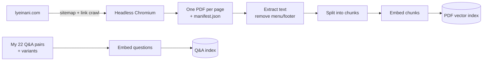
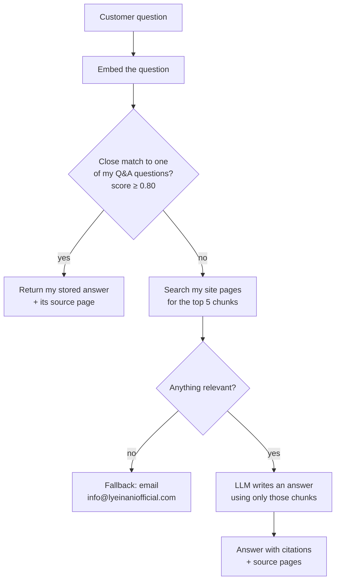

# LYEINANI Customer Assistant: A RAG Chatbot for My Clothing Brand

I built a Retrieval-Augmented Generation (RAG) chatbot that answers customer questions about [lyeinani.com](https://www.lyeinani.com), the Shopify store for LYEINANI, my anime-inspired clothing brand. It answers from two sources I prepared: the pages of my own website, and a set of question-and-answer pairs I wrote for the questions customers ask most.

[](https://colab.research.google.com/github/alwayzlynluv/lyeinani-rag-chatbot/blob/main/lyeinani_rag_chatbot.ipynb)

## Purpose

I run LYEINANI myself, and most of the messages I get are the same few questions: how exchanges work, who pays for return shipping, when a preorder will arrive, whether I ship internationally. The answers are already on my site, but they're spread across policy pages, product pages and my PRETA preorder page, so customers don't always find them.

I wanted an assistant that:
- answers those questions instantly, in my words, 24/7
- only says what my site actually says, and shows the page it came from
- admits when it doesn't know and points people to my email, instead of guessing

This was also my project for showing applied skills in Retrieval-Augmented Generation, context-aware responses and applied NLP, using a real business I know inside and out.

## Summary

- **Data source 1 (d1): my website.** I scraped every page of lyeinani.com and saved each one as a PDF, which gives the bot a full copy of my product pages, collections and policies.
- **Data source 2 (d2): my Q&A set.** I wrote 22 question-and-answer pairs covering returns, exchanges, shipping, customs, preorders, contact and my Brand Support service. Each one includes several ways a customer might phrase the question.
- **How it answers:** the bot checks my Q&A set first. If the question closely matches one of mine, it gives my stored answer word for word. If not, it searches my site pages and has a language model write an answer using only what it found, with sources.
- **Model:** a free, open-source model (Qwen2.5-1.5B-Instruct) that runs inside Google Colab. No paid service or API key is needed.
- **Interface:** a Streamlit chat app that shows every answer along with where it came from.

## How it works (mapping)

### Building the knowledge base



### Answering a question



## Process: the steps I took

**1. Chose my tools.** I compared AI platforms (Claude, GPT, Gemini, Grok, IBM watsonx, AWS Bedrock and open-source models). Since the retrieval part is my own code, any model can write the answers, so I kept the model in one swappable piece of code.

**2. Scraped my website into PDFs (d1).** I wrote a Python scraper (`lyeinani_scraper.py`) that:
- reads my Shopify sitemap, then follows links to catch any pages the sitemap misses (my sitemap listed 69 pages)
- opens each page in a headless browser so prices and other content that loads with JavaScript are captured
- skips cart, checkout, account and search pages, and saves each product once even though Shopify lists it under several URLs
- saves a `manifest.json` with each page's URL and title, so the bot can cite its sources

**3. Wrote my Q&A set (d2).** I started from my live return policy, shipping policy, PRETA page and Brand Support page, then added details my site doesn't spell out yet:
- LYEINANI pays for return shipping
- preorders can be exchanged if the size is available
- my preorder timeline estimate: production averages 4–6 weeks, customs about 20 days, and shipping 1–2 weeks, so roughly 8–11 weeks in total

Each pair has a category, several alternate phrasings and its source page (`lyeinani_qa_set.json`).

**4. Built the RAG pipeline (`rag_bot.py`).**
- **Embeddings:** `all-MiniLM-L6-v2` turns questions and text into vectors, so the bot can match by meaning, not exact words.
- **Q&A routing:** every incoming question is compared with all my stored questions and variants. A score of 0.80 or higher counts as a strong match.
- **Cleaning:** every page of my site repeats the same menu and footer. I remove lines that appear on most pages so they don't crowd out the real content.
- **Chunking:** page text is split into roughly 900-character pieces with some overlap, each tagged with its page title.
- **Grounded answers:** the model is told to answer only from the retrieved excerpts, cite them, never invent prices, dates or policies, and ignore any instructions inside page content.
- **Follow-ups:** chat history is passed along, so a question like "what about the vest?" keeps its context.

**5. Tuned the threshold.** I tested paraphrases of my stored questions (which should match my Q&A set) against product questions (which should go to the site search) and checked that 0.80 separated them correctly.

**6. Switched to a free model.** My first version used the Claude API, which needs a paid API key. I didn't want this project to depend on a paid account, so I switched the default to Qwen2.5-1.5B-Instruct, a free open-source model that runs on Colab's free GPU. The Claude option is still in the code if I ever add a key.

**7. Built the chat app (`app.py`).** The Streamlit app uses `st.chat_input` and `st.chat_message` for the conversation, `st.session_state` to keep the chat history, and `@st.cache_resource` so the models and indexes load once instead of on every question. Each answer shows whether it came from my Q&A set or my site pages, with links, which helps customers trust it and helps me debug. A slider lets me adjust the match threshold live.

**8. Put it all in a Colab notebook.** `lyeinani_rag_chatbot.ipynb` runs the whole project step by step on a free GPU, from scraping to a live demo of the chat app.

## Outcome

- A working chatbot that answers customer questions about LYEINANI from my own website and my own written answers.
- My most common questions get my exact answer instantly, with no model involved.
- Everything else is answered from my site pages, with the sources shown.
- When the bot can't find an answer, it says so and points customers to my email instead of making something up.
- It runs entirely on free tools: Colab, open-source models and Streamlit.

**What I learned:** most of the quality comes from the data, not the model. Cleaning out repeated menus and footers, writing good question variants and tuning the match threshold made a bigger difference than which model writes the answers.

**Limitations:** the free 1.5B model writes simpler answers than a large paid model. The scraped site is a snapshot, so I re-run the scraper when my site changes. And the answers I added in my Q&A set should also go on my policy pages, so both sources agree.

**Next steps:** embed the assistant on my Shopify store, turn it into a chat bubble on every page, and add automatic answer-quality checks (for example, with RAGAS).

## Examples

These show both routes. Q&A answers come back exactly as I wrote them.

**1. Stored Q&A match**
> **Customer:** Who pays for return shipping?
>
> **Assistant:** LYEINANI pays for return shipping on eligible exchanges. The original shipping fee from your order is non-refundable.
>
> *Route: Q&A · Source: [Refund & Exchange Policy](https://www.lyeinani.com/pages/refund-exchange-policy)*

**2. Paraphrase matched to a stored answer**
> **Customer:** my preorder doesn't fit, can i swap it for another size?
>
> **Assistant:** Yes, preorder items can be exchanged if your size is available. The standard exchange rules still apply: submit your claim within 15 business days of delivery, with the item unworn, unwashed, and tags attached.
>
> *Route: Q&A · Source: [Refund & Exchange Policy](https://www.lyeinani.com/pages/refund-exchange-policy)*

**3. Preorder timeline**
> **Customer:** When will my preorder ship?
>
> **Assistant:** PRETA is our preorder status page, and it explains the process for every preorder item. As a general estimate, preorders take about 8-11 weeks: production averages 4-6 weeks, customs takes about 20 days, and shipping takes 1-2 weeks. These are estimates, not guarantees. Manufacturing, holidays, and customs can shift them, and confirmed changes are posted on PRETA. For a specific order, contact us with your order number.
>
> *Route: Q&A · Source: [PRETA](https://www.lyeinani.com/pages/pre-order-status)*

**4. Product question answered from my site pages (RAG)**
> **Customer:** How much is the Crimson Bloom Blazer?
>
> **Assistant:** *[TO FILL IN: paste the answer from my Colab run, section 4b]*
>
> *Route: RAG · Sources: [TO FILL IN]*

**5. Collection question answered from my site pages (RAG)**
> **Customer:** What's in the Tokyo 1992 collection?
>
> **Assistant:** *[TO FILL IN: paste the answer from my Colab run, section 4b]*
>
> *Route: RAG · Sources: [TO FILL IN]*

## Project files

| File | What it is |
|---|---|
| `lyeinani_rag_chatbot.ipynb` | Colab notebook that runs the whole project step by step |
| `lyeinani_scraper.py` | Scrapes my site into one PDF per page plus `manifest.json` |
| `lyeinani_qa_set.json` | My 22 Q&A pairs (d2) |
| `rag_bot.py` | The chatbot: embeddings, Q&A routing, site search, answer writing |
| `app.py` | Streamlit chat app |
| `requirements.txt` | Python packages |
| `lyeinani_pdfs/` | My scraped site pages (d1) |

## How to run it

**In Google Colab (easiest):** click **Open in Colab** above, set **Runtime → Change runtime type → T4 GPU**, then **Runtime → Run all**. No API key is needed.

**On a computer:**
```bash
pip install -r requirements.txt
playwright install chromium
python lyeinani_scraper.py --ignore-robots   # scrape the site
python rag_bot.py --test-routing             # check Q&A match scores
streamlit run app.py                         # open the chat app
```

## Tools I used

Python · Playwright · sentence-transformers (all-MiniLM-L6-v2) · Hugging Face transformers (Qwen2.5-1.5B-Instruct) · pypdf · NumPy · Streamlit · Google Colab
